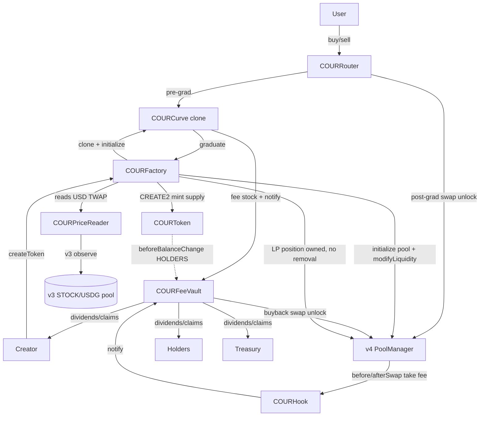

# Architecture

## Contract map

## Launch (`createToken`)
1. Validate: launch fee, not paused, stock allowlisted, fee 100–1000 bps, mode 0–3, ref-pool liquidity ≥ floor.
2. Read `stockUsd` TWAP → `CurveMath.computeLaunchParams` → immutable `vS0, vT0, k, vTStop`.
3. `LibClone.clone(curveImpl)` → curve; `new COURToken{salt}` mints 1e9 to the curve (HOLDERS mode wires the vault as `holderRewards`).
4. Register in factory maps + `feeVault.registerToken`; `curve.initialize(cfg)`.
5. Optional tax-free `initialBuy` (fee applies; capped < 50% supply, cannot graduate).
6. Emit `TokenLaunched`.

## Buy (curve)
`gross → tax(if in-window) + fee(bps on gross) → net`; `CurveMath.buy` on `net`; if it crosses `vTStop`, cap at the stop, refund unused gross (incl. proportional fee/tax), and graduate in-tx. Fee+tax → vault (`transfer` + `notify`). Tokens → buyer. Rounding always favours the curve.

## Sell (curve)
`CurveMath.sell` → gross stock out; `fee = bps·gross`; user gets `gross − fee`; fee → vault. No launch tax. Invariant `vS ≥ vS0` preserved.

## Graduate (`factory.graduate`, onlyCurve)
Pull raised stock + unsold tokens from the curve → `poolManager.initialize(key, sqrtPrice)` at the reserve ratio → `modifyLiquidity` full range (owned by the factory, **no removal path** = burned) → token dust to DEAD, stock dust to the platform bucket → emit `Graduated`.

## Pool swap fee (hook)
- Buy (stock in): `beforeSwap` takes `fee = bps·amountIn (+ tax if in-window)` from the input via `BeforeSwapDelta` + `poolManager.take(stock, vault)` + `notify`.
- Sell (stock out): `afterSwap` takes `fee = bps·stockOut` from the output via the return delta + `take` + `notify`.
- `sender == vault` (buyback) → no fee. Fee is always in the **stock** currency. Exact-output reverts.

## Fee routing (vault `notify`)
`platform = floor(20%)`, `creatorSide = rest`. By mode: CREATOR → `creatorOwed`; HOLDERS → `accPerShare += creatorSide·1e36/eligibleSupply` (fallback to `creatorOwed` if no eligible holders); BUYBACK/BURN → `buybackOwed`.

## Claim / buyback
- `claim` (feeRecipient) → `creatorOwed`; `claimHolder` (any holder) → pro-rata; `claimPlatform` (anyone) → treasury.
- `executeBuyback` (feeRecipient, modes 2/3): min-$50 + 2%-of-reserve + (post-grad) 3% TWAP-deviation guards; pre-grad buys on the curve, post-grad swaps the pool; tokens to feeRecipient (BUYBACK) or DEAD (BUYBACK_BURN).

## Indexer notes (Phase 1C)
Events carry full state for reconstruction: `TokenLaunched` (params + start price + mode + uri), `CurveTrade` (stock/token/fee/tax/vS/vT per trade), `Graduated` (poolId + liquidity), `FeeTaken` (creator-side/platform split), `FeeClaimed`/`HolderClaimed`/`BuybackExecuted`/`PlatformClaimed`, `FeeRecipientChanged`, and admin events. An indexer can rebuild every chart, the holder list (from token Transfers + `beforeBalanceChange` eligibility rules), and fee dashboards without extra RPC calls.

## Off-chain components (added 2026-11-05)

Beyond the contracts, COUR now ships three off-chain services (each with its own README):

- **Indexer (`indexer/`, Ponder).** Subscribes to the final deployment's events (`TokenLaunched`,
  `CurveTrade`, `Graduated`, `FeeTaken`, claims, `BuybackExecuted`, admin events) plus dynamic Curve/Token
  contracts and the v4 PoolManager swaps for graduated pools. Derives tokens, trades, OHLCV candles (stock &
  USD), holders, fee/claim/buyback history, per-stock USD snapshots (from `PriceReader.stockUsd`), and user
  stats. Exposes GraphQL + a REST API consumed by the frontend. USD = price-in-stock × stockUsd.
- **Frontend (`frontend/`, Vite + viem).** The approved design wired to the live contracts (via `COURRouter`
  for buy/sell/launch/claim/buyback, `COURFactory` for `createToken`, `COURPriceReader` for prices) and the
  indexer for lists/charts/history. Wallet via EIP-6963. Allowlist-aware launch UI. Unsupported Phase-1
  features (LP provisioning, limit orders) are shown as "Coming soon"; see `docs/FRONTEND_CHANGES.md`.
- **Monitor (`monitor/`, viem).** Watches admin/critical events and periodic health (prices, balances, paused
  state, ownership) and alerts to Telegram (console fallback), with a read-only `/status` + `/health` HTTP.
  Incident procedures in `docs/INCIDENT_RUNBOOK.md`.

Data flow: contracts (chain 4663) → indexer (Postgres) → frontend (reads indexer REST/GraphQL + direct
on-chain for quotes/balances/allowlist). Monitor reads the chain directly, independent of the indexer.
